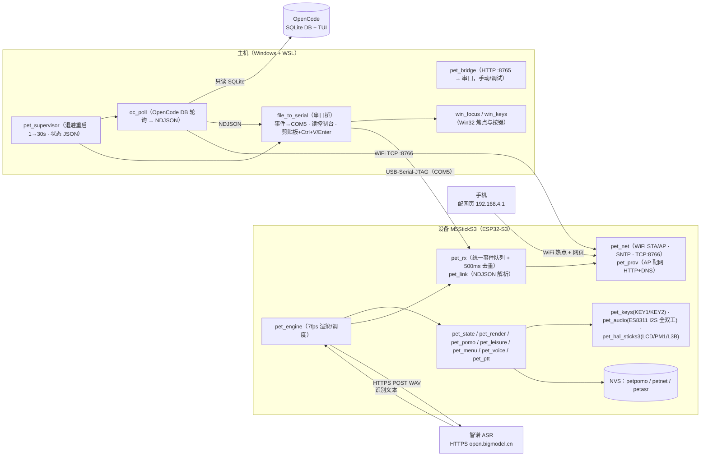
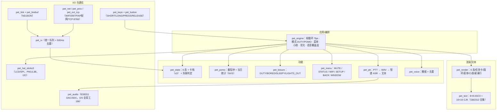
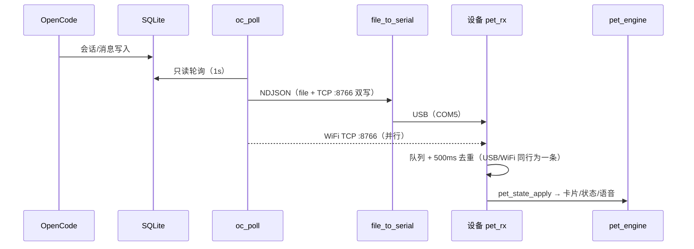
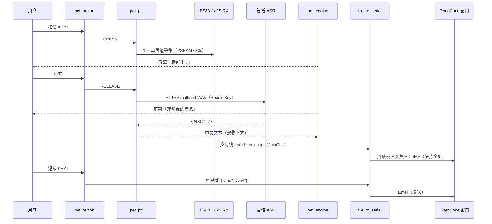
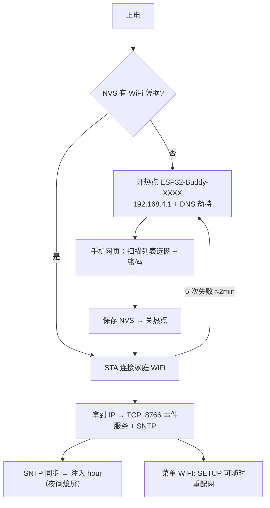

# ESP32-buddy 系统架构图

> 版本：v1.4.0（2026-10-25）　·　设备：M5StickS3（ESP32-S3，135×240，ES8311，8MB Flash/PSRAM）
> 说明：本图由仓库代码还原（`firmware/components/pet/`、`host/`、`.opencode/`）。

## 1. 系统总览



## 2. 设备内部分层



## 3. 事件流（OpenCode → 设备）



## 4. 语音流（长按 KEY1 → 自动填入 → 短按发送）



## 5. 配网与启动



## 6. ASCII 总览（便于终端阅读）

```
┌──────────────────────────── 设备 M5StickS3 (ESP32-S3) ────────────────────────────┐
│  pet_engine (7fps) ── pet_state / pet_pomo / pet_leisure / pet_menu / pet_ptt      │
│      │                    pet_render (135×240) + pet_text (8×8 + 16×16 GB2312)     │
│      ├─ pet_keys/pet_button  KEY1: 长=说话/短=发送   KEY2: 短=番茄钟/长=菜单       │
│      ├─ pet_rx (队列+去重) ← pet_link ← USB-Serial-JTAG / WiFi TCP :8766          │
│      ├─ pet_net (WiFi STA/AP · SNTP · TCP:8766) + pet_prov (AP 配网 HTTP+DNS)      │
│      ├─ pet_audio (ES8311 I2S 全双工 16k：DAC 播报 / ADC 麦克风)                  │
│      └─ NVS: petpomo(统计) / petnet(WiFi) / petasr(ASR Key)                        │
└───────────────┬───────────────────────────────────────────────┬───────────────────┘
                │ USB (COM5)                                    │ WiFi 2.4G
┌───────────────▼──────────────── 主机 (Windows + WSL) ─────────▼──────────────────┐
│ pet_supervisor (退避 1→30s, 状态 JSON)                                            │
│   ├─ oc_poll  ── 只读 SQLite ──► OpenCode DB                                     │
│   └─ file_to_serial  事件→COM5 · 读控制台(IP/voice.text) · 剪贴板+Ctrl+V/Enter    │
│ pet_bridge (HTTP :8765 → 串口, 手动/调试)     win_focus / win_keys (Win32)        │
└───────────────▲───────────────────────────────────────────────────────────────────┘
                │ HTTPS multipart (WAV)
        ┌───────▼────────┐
        │ 智谱 ASR 云端  │ → 识别文本 → 设备 + 剪贴板 → 短按 KEY1 回车
        └────────────────┘
```

## 7. 关键文件映射

| 层 | 文件 |
| --- | --- |
| 设备编排 | `firmware/components/pet/pet_engine.c` |
| 状态/卡栈 | `pet_state.c`、`pet_link.c`、`pet_rx.c` |
| 渲染/文本 | `pet_render.c`、`pet_text.c`、`assets/cjk16.h`、`assets/robot.look` |
| 番茄钟/休闲/菜单 | `pet_pomo.c`、`pet_leisure.c`、`pet_menu.c`、`pet_voice.c` |
| 语音输入 | `pet_ptt.c`、`pet_audio.c`、`pet_button.c`、`pet_keys.c` |
| 通信/配网 | `pet_net.c`、`pet_prov.c`、`pet_evt_tcp.c` |
| 硬件 | `pet_hal_sticks3.c`、`pm1.c`、`es8311/` |
| 主机 | `host/pet_supervisor.py`、`oc_poll.py`、`file_to_serial.py`、`pet_bridge.py`、`win_focus.py`、`win_keys.py` |
| OpenCode | `.opencode/command/esp32-buddy.md`（插件 `.opencode/plugin/voice-draft.ts` 在 1.19.4 不兼容，已停用） |
